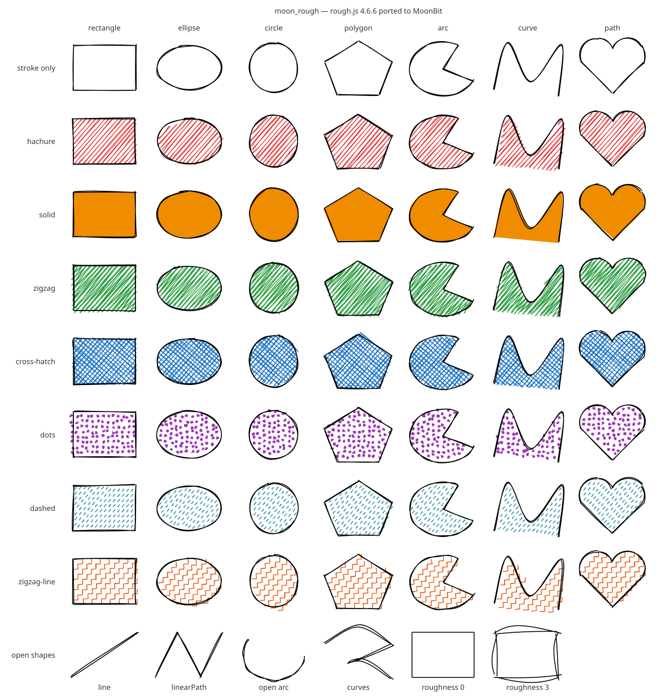

# moon_rough

[rough.js](https://github.com/rough-stuff/rough) 4.6.6 的 MoonBit 移植：把线条、矩形、椭圆、多边形、曲线和 SVG 路径画成手绘草图风格。



（上图由 `moon run src/examples/gallery > gallery.svg` 生成，js / wasm-gc / native 三个后端输出的文件逐字节相同。）

## 定位

rough.js 是 Excalidraw、Mermaid 等工具手绘风格的底层库。MoonBit 生态里目前还没有同类库：Milky2018/diago 的 `CompileOptions.sketch` 目前返回 `UnsupportedFeature`，mizchi/moonlight 也没有手绘渲染。

moon_rough 是**移植**，不是重新实现。目标是：**给定相同的 seed 和参数，生成和 rough.js 一样的图形。**实际结果比这更进一步：在下面的所有对照测试里，MoonBit 和 rough.js 的输出逐位相同，最大误差为 0。

## 用法

```moonbit
fn main {
  let gen = @moon_rough.generator()
  let rect = gen.rectangle(
    10.0, 10.0, 200.0, 100.0,
    options=@moon_rough.Options::new(
      seed=42,
      fill="#e66",
      fill_style=CrossHatch,
      roughness=1.5,
    ),
  )
  // 和后端无关的数据：OpSet 列表，每个 op 是 Move / LineTo / BCurveTo
  for set in rect.sets {
    println("\{set.kind.name()}: \{set.ops.length()} ops")
  }
  // 转成 SVG：每个 OpSet 一个 <path>，整个 Drawable 一个 <g>
  println(@moon_rough.svg_document(220.0, 120.0, @moon_rough.drawable_to_svg(rect)))
}
```

`moon.pkg` 里导入 `"sayoi7799/moon_rough"`。各个子包也可以单独使用：

| 包 | 内容 | 移植来源 |
|---|---|---|
| `sayoi7799/moon_rough` | 门面：`generator()`、常用类型、`drawable_to_svg` | — |
| `.../core` | `Generator`、`Options`、`Drawable` / `OpSet` / `Op`、renderer、7 种填充 | roughjs `generator.ts`、`renderer.ts`、`fillers/*` |
| `.../svg` | `drawable_to_svg`、`svg_document` | roughjs `svg.ts`（输出字符串，不操作 DOM） |
| `.../random` | `Random`（Park–Miller）、`RandomSource` | roughjs `math.ts` |
| `.../path_data` | `parse_path`、`absolutize`、`normalize`（含弧线转贝塞尔）、`serialize` | path-data-parser 0.1.0 |
| `.../curve` | `points_on_bezier_curves`、`simplify`、`curve_to_bezier`、`points_on_path` | points-on-curve 0.2.0、points-on-path 0.2.1 |
| `.../hachure` | `hachure_lines`（扫描线填充） | hachure-fill 0.5.2 |
| `.../geometry` | 可变的 `Point` | roughjs `geometry.ts` |
| `.../jsmath` | 和 V8 逐位一致的 `sin` / `cos`、`Math.round`、`toFixed`、`Number#toString`、`parseFloat`、`Math.min/max` | — |

### API 对照

| rough.js | moon_rough |
|---|---|
| `rough.generator({ options })` | `@moon_rough.generator(options=…, source=…)` |
| `gen.line(x1, y1, x2, y2, o)` | `gen.line(x1, y1, x2, y2, options=o)` |
| `gen.rectangle / ellipse / circle` | 同名方法 |
| `gen.linearPath(points, o)` / `gen.polygon(points, o)` | `gen.linear_path(points)` / `gen.polygon(points)`，`points : Array[(Double, Double)]` |
| `gen.arc(x, y, w, h, start, stop, closed, o)` | `gen.arc(x, y, w, h, start, stop, closed=true)` |
| `gen.curve(Point[])` / `gen.curve(Point[][])` | `gen.curve(points)` / `gen.curves(points_list)` |
| `gen.path(d, o)` | `gen.path(d)`，非法路径 `raise PathError` |
| `gen.opsToPath(set, digits)` / `gen.toPaths(d)` | `ops_to_path(set, fixed_decimals=…)` / `gen.to_paths(d)` |
| `RoughSVG.draw(drawable)` | `drawable_to_svg(drawable)`（属性及顺序与 `setAttribute` 一致） |
| `{ roughness: 2, fillStyle: 'zigzag' }` | `Options::new(roughness=2.0, fill_style=Zigzag)` |

## 支持范围

| 功能 | 状态 |
|---|---|
| 图形：line、rectangle、ellipse、circle、linearPath、polygon、arc（开 / 闭）、curve（单条 / 多条）、path | ✅ 全部 |
| 填充：hachure、solid、zigzag、cross-hatch、dots、dashed、zigzag-line | ✅ 全部 |
| 选项：maxRandomnessOffset、roughness、bowing、stroke、strokeWidth、curveFitting、curveTightness、curveStepCount、fill、fillStyle、fillWeight、hachureAngle、hachureGap、simplification、dashOffset、dashGap、zigzagOffset、seed、strokeLineDash、strokeLineDashOffset、fillLineDash、fillLineDashOffset、disableMultiStroke、disableMultiStrokeFill、preserveVertices、fixedDecimalPlaceDigits、fillShapeRoughnessGain | ✅ 全部（默认值照 `generator.ts`） |
| SVG 路径：M L H V C S Q T A Z 及其相对形式、隐式重复、紧凑数字写法、弧线转三次贝塞尔 | ✅ |
| 输出：Drawable（OpSet 列表）、SVG 字符串、`opsToPath`、`toPaths` | ✅ |
| Canvas 后端、浏览器演示页、与 diago 对接、动画 | ⏳ 后续阶段 |

## 与 rough.js 的差异

正常输入下，输出与 rough.js 逐位一致。差异只出现在 API 形式，以及 rough.js 自身会出错的输入上：

1. **`Math.random()` 可以注入。** rough.js 在三处用未加种子的 `Math.random()`：seed 为 0 时、dots 填充的点位置、hachure 的一个回退分支。所以 rough.js 的 dots 填充即使设了 seed 也不可复现。moon_rough 把这些调用交给 `RandomSource`：默认用 `@random.Rand`，传 `RandomSource::park_miller(n)` 则完全可复现（测试就是这样对照 dots 的）。注意默认的 `@random.Rand` 每次运行起点相同，并不像 `Math.random()` 那样每次不同；需要真随机时请自己提供 `RandomSource::new(f)`。
2. **不修改调用方的数据。** hachure-fill 会原地旋转传入的多边形再转回来，rough.js 用户传进 `polygon()` 的点会被改动最后几位。moon_rough 内部复制一份，并在内部照样保留这种改动（rough.js 后续步骤依赖它）。
3. **rough.js 不会结束的输入，这里会结束：**
   - 起止角相同的 `arc`（以及任何角度步长 ≤ 0 的循环）：跳过该循环；
   - `dashOffset + dashGap = 0` 的 dashed 填充、`zigzagOffset = 0` 的 zigzag-line 填充：不画这条线上的填充；
   - `Z` 后面跟数字（如 `M 1 1 Z 5`）：path-data-parser 会无限循环，这里 `raise NumberAfterClose`。
4. **rough.js 抛异常的输入：** 非法路径数据 `raise PathError`（`InvalidCharacter(偏移)` / `ParamNotANumber` / `EndedShort`）；带图案填充的空 `polygon([])` 不画填充（hachure-fill 会抛 TypeError）；`curve_to_bezier` 少于 3 个点时 `raise CurveTooShort`。
5. **以 npm 实际加载的 bundle 为准。** `generator.path()` 的第三个 `replace` 在 `bin/` 里是 `'/(\s\s)/g'`，在 `bundled/rough.cjs.js` 里是 `"/(ss)/g"`（都是字符串而非正则，正常路径下都不起作用）。这里照 Node 实际运行的 bundle 实现。
6. **类型收紧：** `seed` 是 32 位 `Int`（rough.js 接受任意 number）；`fixed_decimal_place_digits` 限制在 0–100（JS 超出范围会抛 RangeError）；`fill_style` 是枚举，`FillStyle::from_name` 和 rough.js 一样，未知名称按 `hachure` 处理。
7. **未移植：** Canvas 后端（`RoughCanvas`）、DOM 版 `RoughSVG`（改为输出字符串）、`OpSet` 里生成器从不填写的 `size` / `path` 字段，以及 `_curve` 的 `closePoint` 分支（4.6.6 的所有调用方都传 `null`）。
8. **roughness < -1 的 path：** points-on-path 会用负的简化距离无限递归，这里同样不支持。

## 怎么保证一致

- **随机数顺序。** rough.js 很多地方在一个表达式或参数列表里多次取随机数，JS 从左到右求值，差一次后面就全错。移植时每次取随机数都单独写成一条语句，按 JS 的求值顺序排列（例如 `_bezierTo` 里终点的随机数先于控制点，ellipse 的 `_offset(0.1, _offset(0.4, 1, o), o)` 内层先算）。fixture 生成器包装了 `Math.imul`（bundle 里只有 `Random.next` 用它）和 `Math.random`，记录每个用例取了多少个随机数，测试先比较次数，再比较数值。
- **对象共享语义。** rough.js 的随机数生成器懒创建在 options 对象上；`{ ...o }` 复制时，已存在的会被共享，还不存在的则各自新建；`cloneOptionsAlterSeed` 用 seed + 1 重新开始；不传 options 时，所有图形共用生成器的默认 options 对象，随机状态跨调用延续。MoonBit 里带 `mut` 字段的 struct 是引用类型，`{ ..o, f: v }` 复制的是指针，行为和 JS 相同。点也是可变的引用对象，JS 共享数组的地方 MoonBit 也共享（比如 `simplify` 对单点集合返回 `[p, p]`，hachure 会把它旋转两次）。
- **浮点函数。** native 后端上，core 的 `sin` / `cos` 调用 C 库，约 2.5% 的参数与 V8 差 1 ulp。这种差别会翻转离散判断（循环终止、`Math.round`、ceil / floor 计数、`toFixed(9)`），使 op 数量都对不上。所以 `jsmath` 在 native 上改用 fdlibm 算法（与 V8 和 core 的 wasm 实现相同）。另外按 ECMAScript 规范精确实现了 `toFixed`、`Math.round`、`Math.min/max`（含 NaN 和 ±0 的处理），并验证了 `Math.pow(x, 2) === x * x`、`%` 与 JS 一致。

## 测试

```bash
moon test --target js
```

```bash
moon test --target wasm-gc
```

```bash
moon test --target native
```

所有预期值都来自官方 rough.js（见下一节），没有手写的数值预期：

| 类别 | 内容 |
|---|---|
| 底层 | Random 13 个 seed（含 −2³¹、2³¹−1、`cloneOptionsAlterSeed` 产生的非 int32 的 2³¹）各前 1000 个输出、seed 0 的回退；约 2.9 万条数学 / `toFixed` / `toString` / `parseFloat` 用例；456 条路径的 parse / absolutize / normalize / serialize；Bézier 采样、简化、`curveToBezier`、`pointsOnPath`（含点对象的身份）；600 组 hachure-fill（含旋转回来后的多边形坐标） |
| 图形 × 填充 | 642 个用例：所有图形 × 描边 / solid / hachure × 多组选项；415 个用例：8 种可填充图形 × 7 种填充 × 多组选项 |
| 随机组合 | 600 组随机图形 + 随机选项（roughness、bowing、角度、间距、preserveVertices、disableMultiStroke(Fill)、曲线参数、虚线 / 锯齿参数、simplification、各种 fill 值和填充样式） |
| 边界情况 | 宽高为 0、长度为 0、roughness 0、单点 / 两点 / 空的 polygon、linearPath 和 curve、空路径、只有 M 的路径、带相对命令和弧线的复杂路径、非法路径（返回错误）、无穷坐标、curveStepCount 1 和 2 等 321 个用例；同一生成器连续调用的序列；以及 rough.js 会死循环或抛异常的输入（只检查能正常结束） |

比较方式：shape 名、OpSet 类型、每个 OpSet 的 op 类型序列、随机数调用次数必须完全一致；坐标要求 `|a − b| ≤ 1e-9 × max(1, |b|)`。这个容差只是保险：正常情况下所有运算都是相同顺序的 IEEE 基本运算，结果应逐位相同；而随机数顺序出错造成的偏差在 roughness × offset 量级（0.1–2），1e-9 不可能把它掩盖。

### 误差报告

`node scripts/error_report.mjs` 在三个后端运行测试并汇总每个套件的最大绝对误差（括号里是不逐位相同的数值个数）：

| suite | values | js | wasm-gc | native |
|---|---:|---|---|---|
| core edge cases | 69890 | 0 (0 inexact) | 0 (0 inexact) | 0 (0 inexact) |
| core fills | 309900 | 0 (0 inexact) | 0 (0 inexact) | 0 (0 inexact) |
| core random | 249504 | 0 (0 inexact) | 0 (0 inexact) | 0 (0 inexact) |
| core sequences | 3248 | 0 (0 inexact) | 0 (0 inexact) | 0 (0 inexact) |
| core shapes | 196962 | 0 (0 inexact) | 0 (0 inexact) | 0 (0 inexact) |
| curve curve_to_bezier | 10614 | 0 (0 inexact) | 0 (0 inexact) | 0 (0 inexact) |
| curve points_on_bezier_curves | 51712 | 0 (0 inexact) | 0 (0 inexact) | 0 (0 inexact) |
| curve points_on_path | 67786 | 0 (0 inexact) | 0 (0 inexact) | 0 (0 inexact) |
| curve simplify | 7796 | 0 (0 inexact) | 0 (0 inexact) | 0 (0 inexact) |
| hachure | 994388 | 0 (0 inexact) | 0 (0 inexact) | 0 (0 inexact) |
| jsmath trig | 28085 | 0 (0 inexact) | 0 (0 inexact) | 0 (0 inexact) |
| path_data | 43038 | 0 (0 inexact) | 0 (0 inexact) | 0 (0 inexact) |
| random | 13000 | 0 (0 inexact) | 0 (0 inexact) | 0 (0 inexact) |

共比较 2,045,923 个值，**三个后端的最大误差都是 0**（moon 0.1.20260920 / moonc v0.10.14，Windows 11，Node 24.20）。

## 重新生成 fixtures

wasm-gc 后端不能读文件，所以 fixtures 生成为 `.mbt` 测试文件，放在被测包旁边（`src/*/…_fixtures_test.mbt`）。双精度数按 IEEE-754 的 16 位十六进制位模式存储，不经过任何十进制解析。

```bash
cd scripts && npm ci && npm run gen
```

- 来源：`scripts/package.json` + `package-lock.json` 锁定 **roughjs 4.6.6**，以及 hachure-fill 0.5.2、path-data-parser 0.1.0、points-on-curve 0.2.0、points-on-path 0.2.1（通过 `overrides` 固定）。脚本启动时会检查这些版本。
- Drawable 用例用 Node 调用 `require('roughjs')`（即 `bundled/rough.cjs.js`）的 `rough.generator()` 生成，不需要浏览器；底层用例直接调用各依赖包和 `roughjs/bin/math.js`。
- `Math.random` 被替换成固定的 Park–Miller 序列（seed 1234567），测试注入同一序列。
- 只生成某几类：`node gen_fixtures.mjs random jsmath path_data curve hachure core_shapes core_fills core_random core_edge svg`。
- 输出确定，重新生成不会产生 diff。每个用例的数据上限为 6 万字符（极密的填充会产生几 MB 的 op），生成器会检查每种"图形 × 填充"组合仍被覆盖。

## 移植来源和许可证

本项目以 MIT 许可证发布（见 [LICENSE](LICENSE)）。移植自以下项目，版权声明和许可证全文见 [THIRD_PARTY_LICENSES](THIRD_PARTY_LICENSES)：

| 项目 | 版本 | 许可证 | 作者 |
|---|---|---|---|
| [roughjs](https://github.com/rough-stuff/rough) | 4.6.6 | MIT | Preet Shihn |
| [hachure-fill](https://github.com/pshihn/hachure-fill) | 0.5.2 | MIT | Preet Shihn |
| [path-data-parser](https://github.com/pshihn/path-data-parser) | 0.1.0 | MIT | Preet Shihn |
| [points-on-curve](https://github.com/pshihn/bezier-points) | 0.2.0 | MIT | Preet Shihn |
| [points-on-path](https://github.com/pshihn/points-on-path) | 0.2.1 | MIT | Preet Shihn |

移植范围：上述五个包中由 `rough.generator()` 使用的全部代码（不含 Canvas 与 DOM 部分）。`src/jsmath/trig_native.mbt` 的 sin / cos 改编自 moonbitlang/core（Apache-2.0），其算法源自 fdlibm（Sun Microsystems 的许可声明），两者的声明同样收录在 THIRD_PARTY_LICENSES 中。测试 fixtures 是用上述 MIT 软件生成的输出数据。
