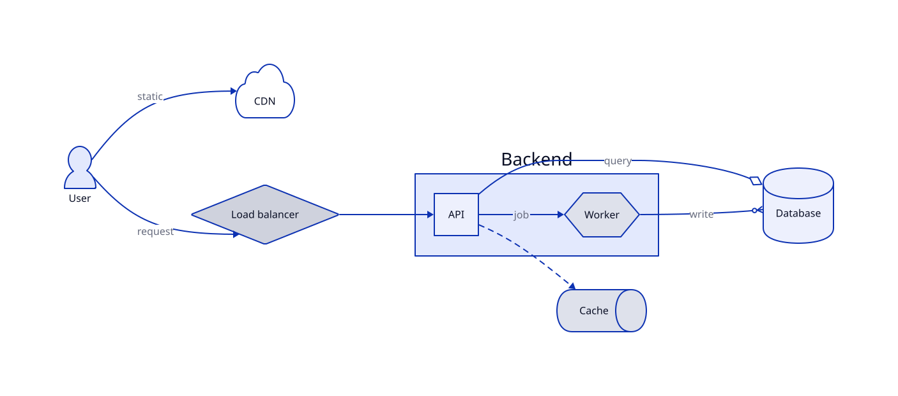
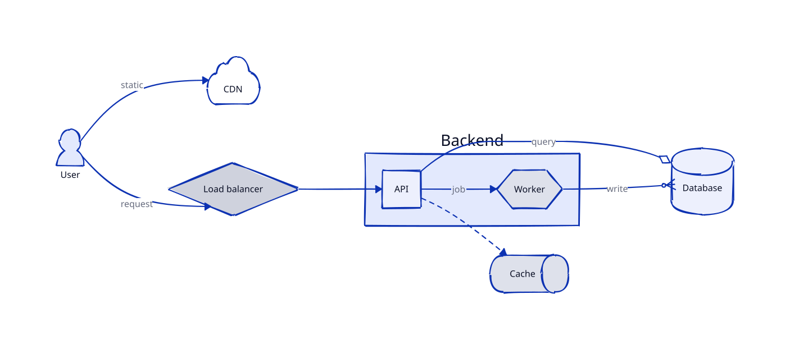

# diago_sketch

用 moon_rough 把 [diago](https://github.com/moonbit-community/diago) 画出来的流程图改成手绘风格。

diago 0.4.0 自己的 `sketch` 选项还没有实现（传进去会得到 `UnsupportedFeature`）。这个模块换了个办法：先让 diago 照常生成 SVG，再把图形的几何替换成 moon_rough 画的手绘线条。文字、颜色、主题和深色模式都保持原样。

| 普通版（diago） | 手绘版（moon_rough，seed 7） |
|---|---|
|  |  |

两张图来自同一段 D2 源码，见 [`demo_diagram/demo_diagram.mbt`](demo_diagram/demo_diagram.mbt)。

## 用法

```moonbit
let svg = @diago.compile(source)
let sketch = @diago_sketch.sketchify(svg, seed=7)
```

`sketchify(svg, seed? = 1, roughness? = 1.0)` 是纯函数：同样的输入、seed 和 roughness，输出逐字节相同，在 js、wasm-gc、native 和不同系统上都一样。第 n 个被替换的元素用 seed + n，n 按它在文档里的顺序算，所以两个一模一样的矩形画出来也不一样。输入不是能读的 SVG（标签或引号没有闭合）时抛 `SketchError`。

重新生成示例图：

```bash
moon run cmd/plain > demo.svg
```

```bash
moon run cmd/sketch > demo-sketch.svg
```

## 做了什么

只替换几何，其余原样复制：

| diago 输出里的 | 处理 |
|---|---|
| `<g class="shape">` 里的 `rect`、`ellipse`、`circle`、`polygon`、`path`、`line` | 换成两条路径：实心填充和手绘轮廓。`fill-*` 的 class 留给填充，`stroke-*` 的留给轮廓，否则主题的 CSS 会把轮廓也涂满 |
| `<marker>` 里的箭头图形 | 就地换成手绘版，并给 marker 加 `overflow="visible"`，免得抖动的线条被裁掉。方向由浏览器按 `orient="auto"` 处理，不需要自己算 |
| 连线 `path.connection` | 只换 `d`，保留 `marker-end`、`mask`、虚线。端点不动，这样箭头仍然贴着形状 |
| 文字、`<style>`、`<mask>`、背景、其他 | 一个字节都不改 |

颜色只写在元素自己带着颜色的地方；从外层 `<g>` 继承来的（例如鸟足形箭头），新路径继续继承，主题照样生效。

扫描器只读标签和属性，不解析整个文档，所以替换以外的内容不可能被弄坏。

## 做不到的

- diago 自己的手绘模式还有 hand-drawn 字体和纹理叠加层，这里没有，文字保持原来的字体。
- 图标、图片、Markdown 标签保持原样。
- 它依赖 diago 当前输出的结构（`<g class="shape">`、`<marker>`、`class="connection"`），所以依赖固定在 diago 0.4.0。diago 改了输出格式，这里就要跟着改。
- 只处理能识别的几何；容器、表格等形状里认不出来的元素会保持原样，个别图会是"一部分手绘"。

如果 diago 以后自己支持 sketch，这个模块就可以去掉。见 [diago 的 issue](https://github.com/moonbit-community/diago/issues/30)。

## 测试

```bash
moon test --target js
```

```bash
moon test --target wasm-gc
```

```bash
moon test --target native
```

覆盖每种图形元素、class 和 style 的拆分、缺 fill 或 stroke、继承的颜色、原样复制、畸形输入、可复现性，并把输出和直接调用 moon_rough 的结果比较。其中一条快照里的路径，和官方 rough.js 4.6.6 用同样参数生成的逐字符相同。最后一条测试用 diago 的真实输出，检查形状里没有剩下的几何元素。
